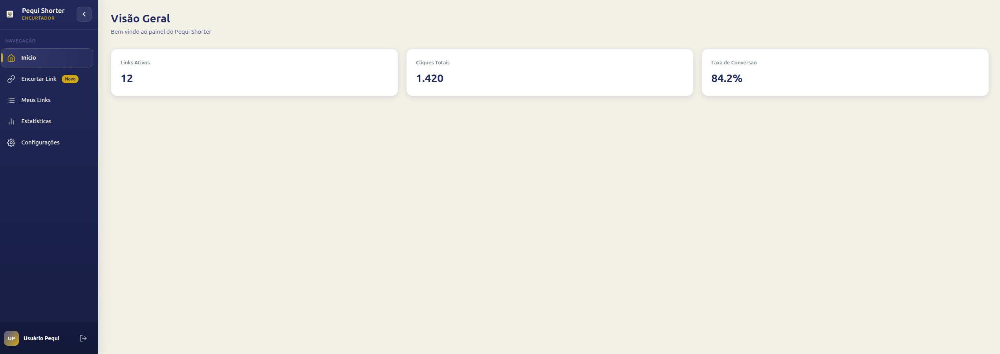
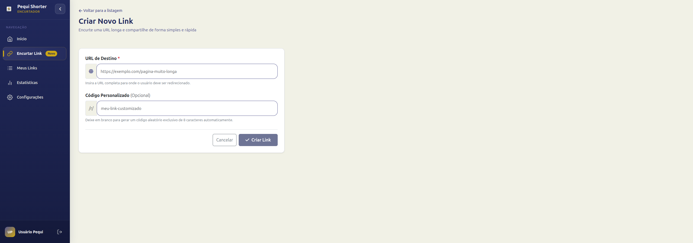
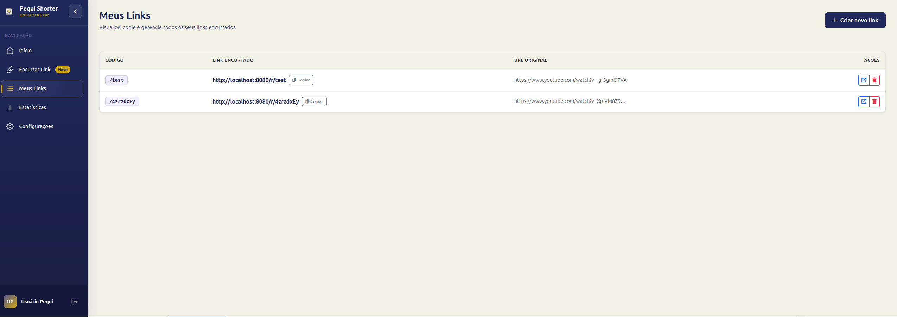
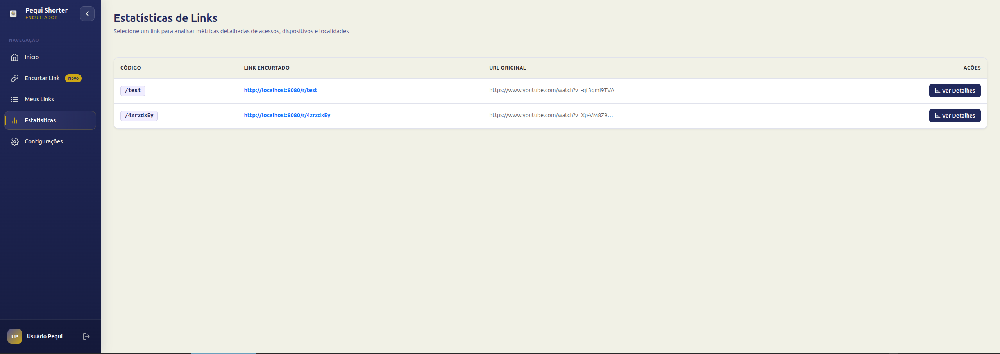
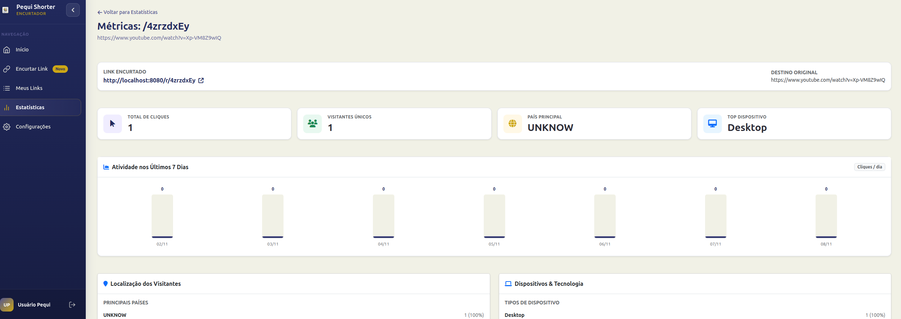
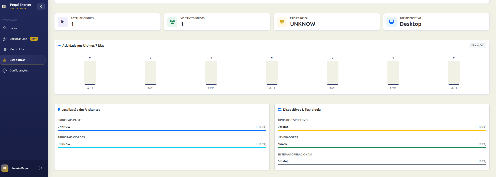

<p align="center">
  
</p>

<h1 align="center">Pequi Shorter — Frontend</h1>

<p align="center">
  Modern, responsive web interface for URL shortening, real-time analytics monitoring, and geographic & device telemetry.
</p>

<p align="center">
  
  
  
  
  
</p>

---

## 📖 Overview

**Pequi Shorter Frontend** is a Single Page Application (SPA) built with **Angular 21**, **Bootstrap 5**, and custom **SCSS**. It provides an intuitive, streamlined interface for users and administrators to shorten long URLs, assign custom codes, manage active links, and analyze access data in real time — including click counts, unique visitors, geographic distribution (countries and cities via MaxMind GeoLite2), and visitor hardware & software profiles (devices, browsers, and operating systems).

---

## 🌐 Ecosystem Architecture

The Pequi Shorter ecosystem consists of two decoupled applications:

```
pequi-shorter/
├── pequi-shorter-api/      # Backend REST API (Kotlin + Spring Boot 4 + PostgreSQL)
└── pequi-shorter-front/    # Frontend SPA (Angular 21 + Bootstrap 5) [THIS REPOSITORY]
```

```
┌─────────────────────────────────┐               ┌──────────────────────────────────┐
│      pequi-shorter-front        │  HTTP / JSON  │        pequi-shorter-api         │
│         (Angular 21)            │ ────────────▶ │     (Spring Boot 4 / Kotlin)     │
│      http://localhost:4200      │ ◀──────────── │      http://localhost:8080       │
└─────────────────────────────────┘  HttpOnly     └──────────────────────────────────┘
                                      Cookies                      │
                                                                   ▼
                                                          ┌──────────────────┐
                                                          │    PostgreSQL    │
                                                          │   pequishortdb   │
                                                          └──────────────────┘
```

---

## 🔗 Backend Reference (`pequi-shorter-api`)

The backend service is located in the adjacent directory: [`../pequi-shorter-api`](../pequi-shorter-api).

### 🛠️ Backend Tech Stack

| Technology | Version | Purpose |
|---|---|---|
| **Kotlin** | 2.3.21 | Primary backend programming language |
| **Spring Boot** | 4.1.0 | Application framework, security & REST controllers |
| **Java** | 21 | LTS Runtime |
| **PostgreSQL** | — | Relational database persistence |
| **Flyway** | — | Database versioning and migrations |
| **JWT (jjwt)** | 0.12.7 | Secure token generation and signature verification |
| **Argon2** | — | Secure cryptographic password hashing |
| **MaxMind GeoIP2** | 5.1.0 | Visitor IP geolocation (country & city lookup) |
| **Springdoc OpenAPI** | 2.8.13 | Interactive documentation via Swagger UI |
| **Docker** | Multi-stage | Containerization and reproducible deployment |

### 📚 API Documentation (Swagger)

When running the backend locally, interactive API documentation is available at:
- **Swagger UI**: [http://localhost:8080/swagger-ui/index.html](http://localhost:8080/swagger-ui/index.html)
- **OpenAPI Spec (JSON)**: [http://localhost:8080/v3/api-docs](http://localhost:8080/v3/api-docs)

### 👤 Test Users (Automatic Seed)

The backend automatically seeds two test accounts upon startup:

| Role | Email | Password | Group | Capabilities |
|---|---|---|---|---|
| **Administrator** | `admin@test.com` | `admin123` | `ADMIN` | Global user, group, rule, and URL administration |
| **Standard User** | `user@test.com` | `user123` | `USER` | Manage and inspect analytics for own shortened URLs |

---

## 🔐 Authentication & Consumed Endpoints

Authentication uses **JWT** stored in secure, `HttpOnly` cookies transmitted transparently via `withCredentials: true`:

1. **Login**: Frontend sends `POST /api/user/auth/login`. The API issues an `access_token` (15 min) and `refresh_token` (15 days) as `HttpOnly`, `Secure` cookies.
2. **Authenticated Requests**: Subsequent API calls automatically include these cookies.
3. **Route Guards**: Angular functional guards (`authGuard` and `loginGuard`) prevent unauthorized route access and protect logged-in state.
4. **Logout**: Clears local session signals and revokes tokens on the backend via `POST /api/user/auth/logout`.

### Endpoints Consumed by the Frontend

| Domain | Method | Backend Route | Frontend Usage |
|---|---|---|---|
| **Auth** | `POST` | `/api/user/auth/login` | Authenticates user & establishes session |
| **Auth** | `POST` | `/api/user/auth/logout` | Revokes refresh token & invalidates session |
| **URLs** | `GET` | `/api/url/get` | Fetches all links belonging to the logged-in user |
| **URLs** | `POST` | `/api/url/save` | Creates a new shortened URL (random or custom code) |
| **URLs** | `DELETE` | `/api/url/delete/{id}` | Deletes a user's shortened link |
| **Metrics** | `GET` | `/api/url/{id}/access` | Fetches telemetry, click logs, and geolocation data |
| **Redirect** | `GET` | `/r/{code}` | Public redirection endpoint handled by backend |

---

## ✨ Features

- 🔑 **Reactive Authentication**: Modern login flow with real-time validation and Angular Route Guards.
- 📊 **Overview Dashboard**: High-level KPI summary cards for active links, total clicks, and conversion rates.
- ✂️ **Flexible URL Shortening**:
  - Auto-generated random 8-character codes.
  - Optional custom alias (e.g. `/r/my-campaign`).
- 📋 **Link Management**: Clean tabular view with one-click clipboard copying, quick external links, and deletion actions.
- 📈 **Detailed Visual Analytics**:
  - 7-day click activity chart.
  - Total click volume and unique visitor counters.
  - Geolocation metrics: top countries and cities via MaxMind GeoIP2.
  - Technology breakdown: device types (Desktop, Mobile, Tablet), web browsers, and operating systems.
- 🎨 **Adaptive Interface**: Collapsible sidebar, clear typography, and responsive layouts across desktops, tablets, and phones.

---

## 📸 System Screenshots

All screenshots are stored in [`public/images/system-screenshots/`](public/images/system-screenshots/).

### 1. Login & Authentication
Clean login portal with secure authentication against the API.

<p align="center">
  
</p>

---

### 2. Dashboard — Overview
Centralized view showing account performance KPIs and summary numbers.

<p align="center">
  
</p>

---

### 3. Create New Link (URL Shortening)
Clean form to enter destination URL with optional custom alias input.

<p align="center">
  
</p>

---

### 4. Link Management — My Links
Table listing short links, original destinations, quick copy actions, and deletion controls.

<p align="center">
  
</p>

---

### 5. Statistics Link Selection
Select any shortened link to inspect its metrics in detail.

<p align="center">
  
</p>

---

### 6. Detailed Metrics — Weekly Activity & Clicks
Interactive 7-day activity bar chart alongside unique visitors and top device indicators.

<p align="center">
  
</p>

---

### 7. Analytics — Geolocation & Technology
Detailed breakdowns by country, city, browser, OS, and hardware type.

<p align="center">
  
</p>

---

## 🛠️ Frontend Tech Stack

| Technology | Version | Purpose |
|---|---|---|
| **Angular** | 21.2.0 | Core SPA framework, signals, and routing |
| **TypeScript** | ~5.9.2 | Type-safe application development |
| **Bootstrap** | ^5.3.8 | Responsive grid system, buttons, and utility classes |
| **RxJS** | ~7.8.0 | Reactive programming for HTTP calls and data streams |
| **SCSS** | — | Modular styling, custom variables, and theme definitions |
| **Font Awesome** | 6.x | Vector icon suite for navigation and UI actions |
| **Vitest** | ^4.0.8 | Fast modern test runner for unit testing |

---

## 🚀 Getting Started

### Prerequisites

1. **Node.js**: Version `18.x` or `20.x` LTS recommended.
2. **npm**: Version `10.x` or higher.
3. **Pequi Shorter Backend**: Running on port `8080`.

> 💡 **Tip for running the backend:**
> In `../pequi-shorter-api`, make sure PostgreSQL is running with the `pequishortdb` database and run `./gradlew bootRun`. Check the [Backend README](../pequi-shorter-api/README.md) for full instructions.

### 1. Clone & Navigate to Frontend Directory

```bash
cd pequi-shorter-front
```

### 2. Install Dependencies

```bash
npm install
```

### 3. Run Development Server

```bash
npm start
# or
ng serve
```

Open your browser and navigate to: [`http://localhost:4200`](http://localhost:4200)

### 4. Build for Production

```bash
npm run build
```

Production-ready assets will be compiled into the `dist/` folder.

### 5. Run Unit Tests

```bash
npm test
```

---

## ⚙️ Environment Configuration

API endpoints are configured in `src/environments/`:

- `environment.ts` (Production):
  ```typescript
  export const environment = {
    apiUrl: 'http://localhost:8080/api',
  };
  ```

- `environment.development.ts` (Development):
  ```typescript
  export const environment = {
    apiUrl: 'http://localhost:8080/api',
  };
  ```

---

## 📂 Project Structure

```
src/
├── app/
│   ├── components/                 # Shared UI components
│   │   ├── page-title-component/   # Dynamic page title & breadcrumbs header
│   │   ├── side-bar-component/     # Collapsible navigation sidebar & logout
│   │   └── user-page-compnent/     # Layout wrapper for authenticated views
│   ├── core/                       # Core business logic
│   │   ├── guards/                 # Route guards (authGuard, loginGuard)
│   │   ├── models/                 # TypeScript interfaces and DTOs
│   │   └── services/               # HTTP client services (AuthService, UrlService)
│   ├── features/                   # Feature views and pages
│   │   ├── home-component/         # Overview Dashboard
│   │   ├── login-component/        # Login page
│   │   ├── stats-detail-component/ # Detailed analytics per link
│   │   ├── stats-list-component/   # Link selector for statistics
│   │   ├── url-form-component/     # URL shortening form
│   │   └── url-list-component/     # User's shortened links list
│   ├── styles/                     # Global SCSS styles and design tokens
│   ├── app.config.ts               # Angular application config & providers
│   └── app.routes.ts               # Route mapping and guard definitions
├── assets/                         # Static assets (Font Awesome fonts & SCSS)
├── environments/                   # Environment configuration files
└── public/
    ├── images/
    │   └── system-screenshots/     # Application screenshots
    └── logos/                      # Official brand logos
```

---

## 📄 License

This project is a personal side-project for study and portfolio purposes. See also the [Pequi Shorter API Documentation](../pequi-shorter-api/README.md).
